# C3 物理解谜关卡（30 关）

6 章 × 5 关，每章按「教学 → 练习 → 变化 → 组合 → 挑战」排列。规划关 24 个、实时关 6 个。

## 文件

| 路径 | 内容 |
|---|---|
| `src/modes/puzzle/levels/c3/c3-*.json` | 30 个正式关卡，格式版本 1，参考解法由回放生成 |
| `src/modes/puzzle/levels/c3/meta.json` | 中英文关名、描述、三级提示、机制，以及每关全部解法的笔画日志 |
| `tools/c3/levels.src.mjs` | 关卡源定义（改关卡改这里，再跑构建） |
| `tools/c3/build.mjs` | 源定义 → 关卡 JSON 和 meta.json |
| `tools/c3/audit.mjs` | 全量验证，写出 `docs/puzzle-levels-report.json` 并重新生成本文档 |
| `tools/c3/try.mjs` | 设计时用：打印某关某解法的字符画和检查结果 |
| `tools/c3/shots.mjs` | 用真实页面给每关拍初始画面和通关画面，存进 `docs/puzzle-levels/` |
| `tests/suites/c3-levels.test.mjs` | node:test：每关参考解法三星、双播一致、空解失败、备选解法通关 |

```sh
node tools/c3/build.mjs          # 重新生成关卡
node tools/c3/audit.mjs          # 全量验证（随机 200 次、扰动 50 次，约几分钟）
node tools/levels.mjs validate src/modes/puzzle/levels/c3/c3-*.json
node --test tests/suites/c3-levels.test.mjs
```

关卡放在 `levels/c3/` 子目录而不是 `levels/` 根下：`tools/levels.mjs validate`（CI 也跑）会要求 `levels/` 根下的文件和 `catalog.js` 的注册表一一对应，而这个分支不允许改 `catalog.js`。接入时把文件挪上去并注册，英文文本从 meta.json 合进 `src/ui/catalog.js`，见交接文件。

关卡 JSON 的 `hint` 字段放的是一句话目标（中文），选关卡片和游戏里显示的就是它。格式只有一个 `hint` 字符串，没有英文字段、也没有分级提示，所以英文和三级提示放在 meta.json。

## 验证方法

- **参考解法**：`puzzleVerify` 在两个独立世界回放，必须三星、哈希一致。
- **备选解法**：meta.json 里每关至少两种解法，都要能通关（星级可以低）。
- **空解**：什么都不放必须失败。
- **随机机器人**：每次随机 1–6 笔，材料、起点、方向、长度（≤12）、粗细（1–4）、形状（圆、方、喷雾）都随机，受白名单和预算限制；实时关每笔再随机选一个时刻（前 60% 时限内）。每关 200 次，通关率要 < 5%。随机数用 xorshift，种子由关卡 id 派生，结果可复现。
- **抗扰动**（只对规划关）：参考解法每一笔整体随机平移 −1/0/+1 格（x、y 独立），50 次，通关率要 ≥ 80%。
- **实时关的时机检查**：把参考解法的每一笔都提前到第 0 步，记录是否仍能通关；失败说明这关确实考时机。

## 总表

| 编号 | 关卡 | 类型 | 教的机制 | 三星解法 | 随机通关 | 扰动通过 | 难度分 |
|---|---|---|---|---|---:|---:|---:|
| 1-1 | 一斗沙 | 规划 | 重力：粉末自由下落 | 1 笔 · 32 格 · 8 步 | 2/200（1.0%） | 50/50（100.0%） | 59 |
| 1-2 | 靠墙堆沙 | 规划 | 休止角：沙堆坡度固定，靠墙省一半料 | 1 笔 · 41 格 · 12 步 | 6/200（3.0%） | 50/50（100.0%） | 44 |
| 1-3 | 漏斗 | 规划 | 漏斗：陡坡滑落、缓坡留沙 | 1 笔 · 29 格 · 39 步 | 1/200（0.5%） | 50/50（100.0%） | 62 |
| 1-4 | 填平路面 | 规划 | 填平：横向铺开，按容积用料 | 12 笔 · 68 格 · 10 步 | 0/200（0.0%） | 49/50（98.0%） | 96 |
| 1-5 | 沙之考场 | 规划 | 综合：填平、漏斗、休止角 | 6 笔 · 82 格 · 35 步 | 0/200（0.0%） | 50/50（100.0%） | 97 |
| 2-1 | 改道 | 规划 | 引流：水从低的一侧漫出 | 1 笔 · 14 格 · 44 步 | 0/200（0.0%） | 41/50（82.0%） | 62 |
| 2-2 | 渡槽 | 规划 | 连通：搭渡槽把高处的水引到低处 | 1 笔 · 22 格 · 99 步 | 0/200（0.0%） | 44/50（88.0%） | 64 |
| 2-3 | 撇油 | 规划 | 密度分层：重的沉底、轻的上浮 | 1 笔 · 76 格 · 58 步 | 0/200（0.0%） | 50/50（100.0%） | 72 |
| 2-4 | 升筏 | 规划 | 浮力：水涨船高 | 2 笔 · 76 格 · 363 步 | 1/200（0.5%） | 43/50（86.0%） | 73 |
| 2-5 | 分水 | 实时 | 综合：引流、浮力和时机 | 1 笔 · 4 格 · 401 步 | 1/200（0.5%） | —（提前到第 0 步失败） | 51 |
| 3-1 | 篝火 | 规划 | 点火：火往上烧 | 1 笔 · 8 格 · 246 步 | 8/200（4.0%） | 50/50（100.0%） | 27 |
| 3-2 | 防火带 | 实时 | 防火带：浸湿可燃物 | 2 笔 · 13 格 · 1500 步 | 0/200（0.0%） | —（提前到第 0 步仍通关） | 66 |
| 3-3 | 烧桥 | 规划 | 湿木头：浸湿的木头不会着火 | 4 笔 · 26 格 · 1400 步 | 2/200（1.0%） | 46/50（92.0%） | 72 |
| 3-4 | 地窖失火 | 实时 | 灭火：用水隔绝空气、带走热量 | 2 笔 · 148 格 · 195 步 | 0/200（0.0%） | —（提前到第 0 步仍通关） | 80 |
| 3-5 | 烽火台 | 规划 | 综合：引火物、湿木头和引流 | 3 笔 · 35 格 · 1000 步 | 2/200（1.0%） | 46/50（92.0%） | 69 |
| 4-1 | 蒸汽搬水 | 规划 | 汽化与凝结：水遇热成蒸汽，遇冷又成水 | 1 笔 · 67 格 · 205 步 | 7/200（3.5%） | 50/50（100.0%） | 43 |
| 4-2 | 化雪 | 规划 | 熔化：固体吸热变成液体 | 2 笔 · 12 格 · 600 步 | 2/200（1.0%） | 50/50（100.0%） | 58 |
| 4-3 | 浇铸石板 | 规划 | 凝固：熔岩遇水冷却成石 | 2 笔 · 64 格 · 107 步 | 0/200（0.0%） | 50/50（100.0%） | 76 |
| 4-4 | 海水淡化 | 规划 | 综合：蒸馏把盐留下 | 1 笔 · 5 格 · 600 步 | 4/200（2.0%） | 44/50（88.0%） | 40 |
| 4-5 | 雪水上楼 | 规划 | 综合：熔化、汽化、凝结 | 3 笔 · 27 格 · 900 步 | 4/200（2.0%） | 48/50（96.0%） | 60 |
| 5-1 | 支柱 | 规划 | 支撑：刚体要连到地面或锚点 | 1 笔 · 20 格 · 300 步 | 0/200（0.0%） | 50/50（100.0%） | 64 |
| 5-2 | 吊灯 | 规划 | 绳子：把东西吊在锚点上 | 1 笔 · 13 格 · 300 步 | 0/200（0.0%） | 50/50（100.0%） | 61 |
| 5-3 | 定点爆破 | 规划 | TNT 和引线：用火药引爆 | 3 笔 · 13 格 · 400 步 | 8/200（4.0%） | 41/50（82.0%） | 39 |
| 5-4 | 掐断引线 | 实时 | 综合：引线、防火带和时机 | 2 笔 · 9 格 · 1400 步 | 2/200（1.0%） | —（提前到第 0 步仍通关） | 56 |
| 5-5 | 炸坝引水 | 规划 | 综合：支撑、爆破与引水 | 4 笔 · 42 格 · 700 步 | 0/200（0.0%） | 43/50（86.0%） | 83 |
| 6-1 | 接通电路 | 规划 | 导电：电火花沿金属传导 | 2 笔 · 16 格 · 120 步 | 1/200（0.5%） | 50/50（100.0%） | 63 |
| 6-2 | 水渠导电 | 规划 | 导电：水也能传电 | 2 笔 · 20 格 · 105 步 | 4/200（2.0%） | 50/50（100.0%） | 53 |
| 6-3 | 绕开木屋 | 规划 | 导电的副作用：通电金属会发热 | 4 笔 · 88 格 · 400 步 | 5/200（2.5%） | 50/50（100.0%） | 68 |
| 6-4 | 顺水通电 | 实时 | 综合：水流、导电与时机 | 1 笔 · 1 格 · 289 步 | 7/200（3.5%） | —（提前到第 0 步失败） | 21 |
| 6-5 | 一火双响 | 实时 | 综合：导线、水路与时机 | 2 笔 · 7 格 · 293 步 | 9/200（4.5%） | —（提前到第 0 步失败） | 27 |

## 难度曲线

难度分只用客观数据：随机机器人通关率（权重 0.4，0% 记满分，≥5% 记 0）、三星解法的笔数（0.3，6 笔封顶）和用料（0.3，按对数，128 格封顶）。设计难度（JSON 的 `difficulty`，1–5）单独列出作对照。

```
1-1   59 ███████████████
1-2   44 ███████████
1-3   62 ████████████████
1-4   96 ████████████████████████
1-5   97 ████████████████████████
2-1   62 ████████████████
2-2   64 ████████████████
2-3   72 ██████████████████
2-4   73 ██████████████████
2-5   51 █████████████
3-1   27 ███████
3-2   66 █████████████████
3-3   72 ██████████████████
3-4   80 ████████████████████
3-5   69 █████████████████
4-1   43 ███████████
4-2   58 ███████████████
4-3   76 ███████████████████
4-4   40 ██████████
4-5   60 ███████████████
5-1   64 ████████████████
5-2   61 ███████████████
5-3   39 ██████████
5-4   56 ██████████████
5-5   83 █████████████████████
6-1   63 ████████████████
6-2   53 █████████████
6-3   68 █████████████████
6-4   21 █████
6-5   27 ███████
```

| 章 | 第 1 关 | 第 2 关 | 第 3 关 | 第 4 关 | 第 5 关 | 章平均 | 设计难度 |
|---|---:|---:|---:|---:|---:|---:|---|
| 第一章 · 粉末与重力 | 59 | 44 | 62 | 96 | 97 | 71.6 | 1 1 2 2 3 |
| 第二章 · 水与流体 | 62 | 64 | 72 | 73 | 51 | 64.4 | 1 2 2 2 3 |
| 第三章 · 火与热 | 27 | 66 | 72 | 80 | 69 | 62.8 | 1 2 2 3 4 |
| 第四章 · 相变 | 43 | 58 | 76 | 40 | 60 | 55.4 | 2 2 2 3 4 |
| 第五章 · 结构与爆破 | 64 | 61 | 39 | 56 | 83 | 60.6 | 1 2 2 3 4 |
| 第六章 · 天气与电 | 63 | 53 | 68 | 21 | 27 | 46.4 | 2 2 3 3 4 |

- 每章第 5 关（挑战）的难度分不低于第 1 关（教学）的章数：4/6。
- 前 15 关平均 66.3，后 15 关平均 54.1。
- 章平均没有做到逐章上升：71.6 → 64.4 → 62.8 → 55.4 → 60.6 → 46.4。

**结论：按这三项客观指标，30 关的难度没有做到递增。** 原因分两类：

1. 指标本身的偏差。随机通关率在 0–5% 之间，大多数关是 0%，拉不开差距；笔数和用料衡量的是「要放多少东西」，而后期的实时关（2-5、6-4、6-5）难在时机，参考解法只有 1–2 笔、几格料，分数反而最低；1-4 用 12 道一格细线逐行填坑，笔数把分数抬得很高。
2. 关卡本身。第一章的 1-4、1-5 确实偏重（要按容积精确用料）；第六章的电路关机制清楚、用料少，玩起来也偏轻松。每章第 1 关是新机制的教学关，本来就会比上一章的挑战关简单，所以即使指标合理，曲线也会是锯齿形。

要真正检验难度曲线，需要能反映「想到解法有多难」的数据，比如试玩的首次通关时间和尝试次数；或者在指标里加入时机窗口宽度（实时关的可行放置时段占整关时限的比例）。按现有数据，建议优先调整：把 1-4 的解法改成更少笔数的版本或降低精度要求，给 6-4、6-5 收窄可行时段。

## 逐关说明

### 1-1 一斗沙（A Bucket of Sand）

- **id**：`c3-1-1-pour`，规划关，设计难度 1，时限 360 步，总预算 45 格
- **目标**：把至少 30 格沙倒进石槽，别撒到两边的草地上。
- **英文**：Pour at least 30 grains of sand into the stone trough without spilling onto the lawns.
- **教的机制**：重力：粉末自由下落（Gravity: powders fall freely）
- **星级门槛**：二星 用料 ≤ 40、步数 ≤ 300；三星 用料 ≤ 34、步数 ≤ 200
- **预期解法「槽口正上方竖着倒」**：3 星，1 笔、用料 32 格、8 步结算。笔画：SAND (31,2)→(31,11) 粗 2
- **备选解法「宽宽地撒一排」**：1 星，1 笔、用料 45 格、7 步结算。笔画：SAND (28,8)→(35,8) 粗 3
- **提示**：① 沙子会笔直往下落。 ② 在虚线禁建区上面、正对着槽口倒沙。 ③ 在槽中线上方竖着画一道两格粗的沙，大约 30 格就够。
- **难度指标**：随机通关 2/200（1.0%，随机通关中三星 0 次）；扰动通过 50/50，其中三星 50；空解失败；难度分 59
- **截图**：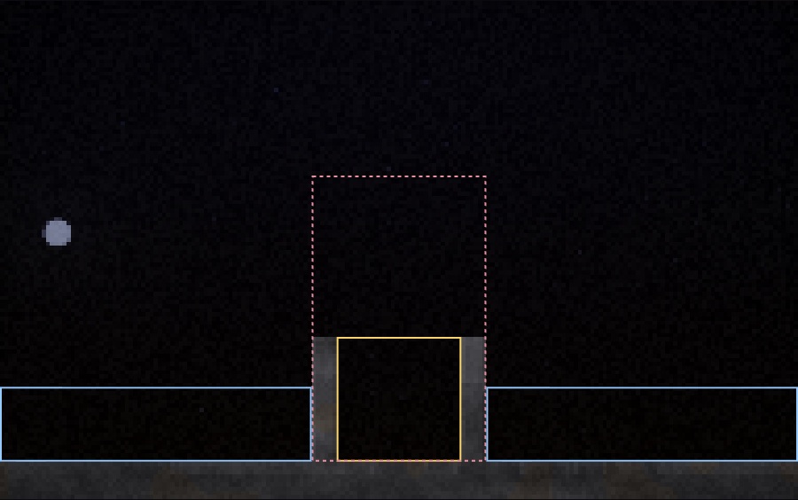 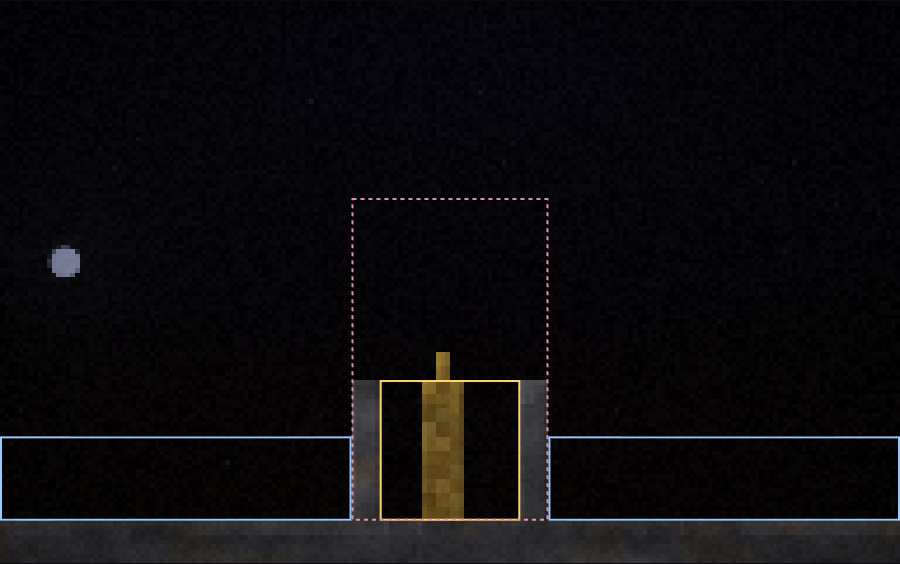

### 1-2 靠墙堆沙（Lean on the Wall）

- **id**：`c3-1-2-repose`，规划关，设计难度 1，时限 450 步，总预算 70 格
- **目标**：让沙堆高到下面的金框里（至少 6 格），上面的金框要留空，沙子不能滚进花园。
- **英文**：Pile sand up into the lower gold frame (at least 6 grains), keep the upper frame empty, and keep sand out of the garden.
- **教的机制**：休止角：沙堆坡度固定，靠墙省一半料（Angle of repose: a pile against a wall needs half the sand）
- **星级门槛**：二星 用料 ≤ 56、步数 ≤ 380；三星 用料 ≤ 44、步数 ≤ 300
- **预期解法「贴着墙倒」**：3 星，1 笔、用料 41 格、12 步结算。笔画：SAND (42,2)→(42,14) 粗 2
- **备选解法「离墙几格多倒些」**：1 星，1 笔、用料 59 格、17 步结算。笔画：SAND (40,2)→(40,20) 粗 2
- **提示**：① 沙堆的坡度是固定的：堆得越高，底就越宽。 ② 墙可以替你挡住沙堆的一半。 ③ 在金框正上方、紧贴石墙竖着倒四十来格沙。
- **难度指标**：随机通关 6/200（3.0%，随机通关中三星 0 次）；扰动通过 50/50，其中三星 50；空解失败；难度分 44
- **截图**：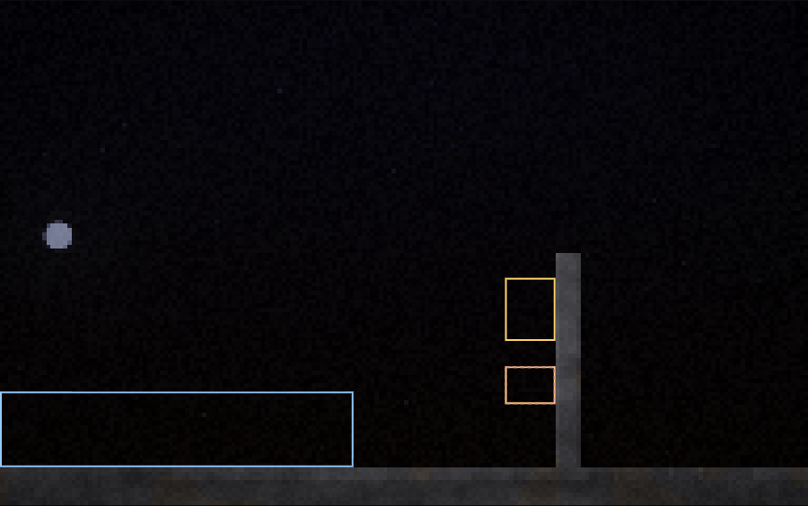 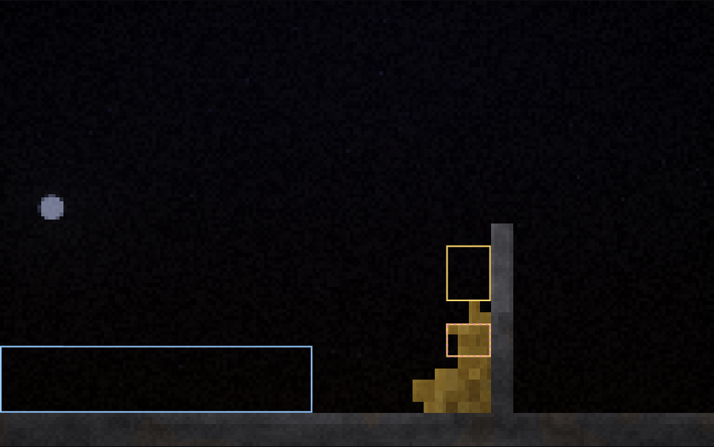

### 1-3 漏斗（The Funnel）

- **id**：`c3-1-3-funnel`，规划关，设计难度 2，时限 450 步，总预算 70 格
- **目标**：把至少 24 格沙送进中间的细管，不能撒到草地上。
- **英文**：Get at least 24 grains of sand into the narrow tube without spilling onto the lawns.
- **教的机制**：漏斗：陡坡滑落、缓坡留沙（Funnels: steep slopes shed sand, gentle slopes keep it）
- **星级门槛**：二星 用料 ≤ 50、步数 ≤ 400；三星 用料 ≤ 32、步数 ≤ 300
- **预期解法「倒在陡的一边」**：3 星，1 笔、用料 29 格、39 步结算。笔画：SAND (23,1)→(23,9) 粗 2
- **备选解法「倒在缓的一边」**：1 星，1 笔、用料 70 格、40 步结算。笔画：SAND (42,1)→(42,12) 粗 3
- **提示**：① 斜面够陡，沙才会滑下去；太缓的斜面会把沙留住。 ② 漏斗左右两边的坡度不一样。 ③ 在左边陡坡的上方倒三十来格沙。
- **难度指标**：随机通关 1/200（0.5%，随机通关中三星 0 次）；扰动通过 50/50，其中三星 50；空解失败；难度分 62
- **截图**：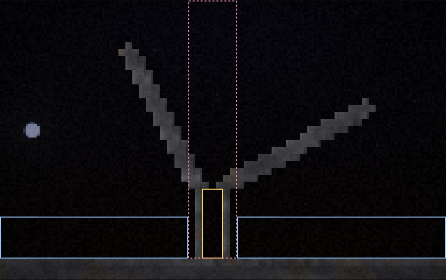 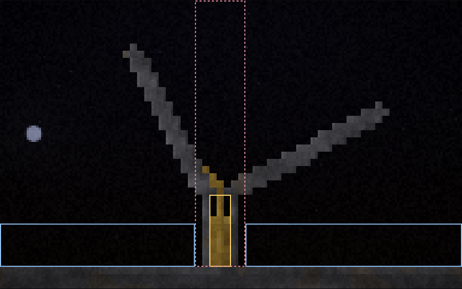

### 1-4 填平路面（Level the Road）

- **id**：`c3-1-4-level`，规划关，设计难度 2，时限 500 步，总预算 110 格
- **目标**：把路上的两个坑填平：坑里要填满，路面上不能堆出沙包。
- **英文**：Fill both potholes in the road: they must be full, with no mound of sand left on the road.
- **教的机制**：填平：横向铺开，按容积用料（Levelling: spread sideways and match the volume）
- **星级门槛**：二星 用料 ≤ 86、步数 ≤ 400；三星 用料 ≤ 74、步数 ≤ 300
- **预期解法「比坑窄一格、一行一行铺」**：3 星，12 笔、用料 68 格、10 步结算。笔画：SAND (13,3)→(20,3) 粗 1；SAND (13,6)→(20,6) 粗 1；SAND (13,9)→(20,9) 粗 1；SAND (13,12)→(20,12) 粗 1；SAND (13,15)→(20,15) 粗 1；SAND (41,0)→(44,0) 粗 1；SAND (41,3)→(44,3) 粗 1；SAND (41,6)→(44,6) 粗 1；SAND (41,9)→(44,9) 粗 1；SAND (41,12)→(44,12) 粗 1；SAND (41,15)→(44,15) 粗 1；SAND (41,18)→(44,18) 粗 1
- **备选解法「方笔刷分几块」**：3 星，5 笔、用料 70 格、10 步结算。笔画：SAND (14,6)→(18,6) 粗 2 square；SAND (14,12)→(18,12) 粗 2 square；SAND (42,4)→(43,4) 粗 2 square；SAND (42,9)→(43,9) 粗 2 square；SAND (41,14)→(44,14) 粗 1
- **提示**：① 往一个点倒沙会堆成尖堆，坑角还空着，中间已经冒出来了。 ② 按坑的宽度横着铺，用量和坑的格数差不多。 ③ 左坑 10×4、右坑 6×5：各画一道和坑一样宽的横线，用量刚好够填满。
- **难度指标**：随机通关 0/200（0.0%，随机通关中三星 0 次）；扰动通过 49/50，其中三星 49；空解失败；难度分 96
- **截图**：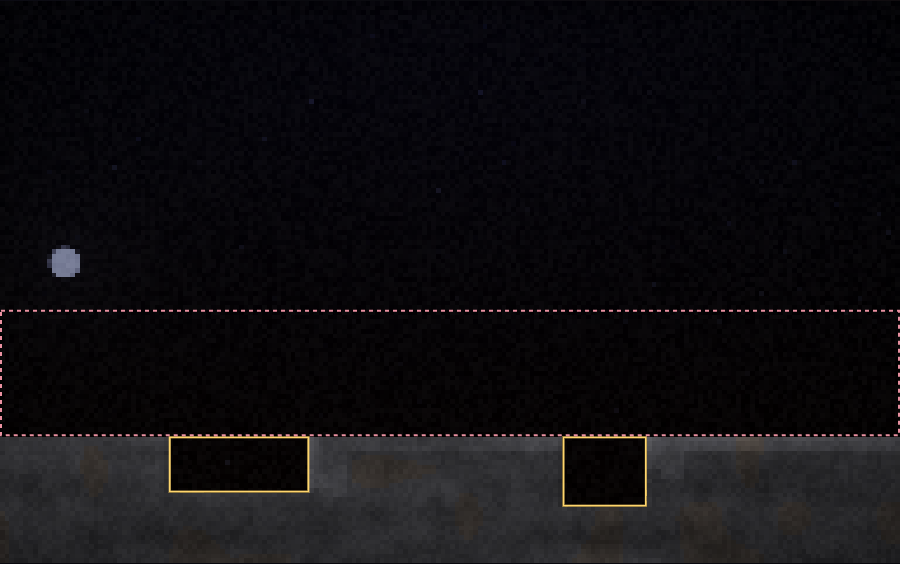 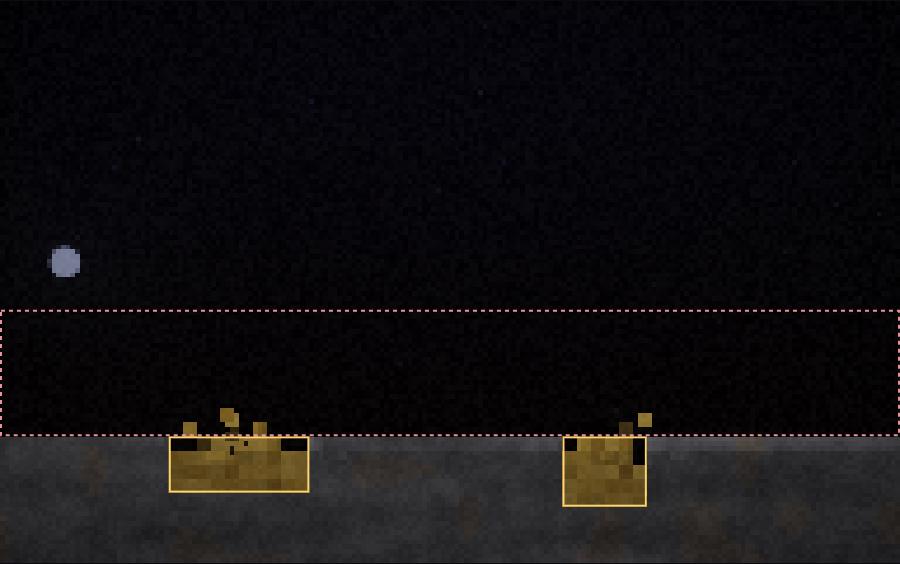

### 1-5 沙之考场（Sand Finals）

- **id**：`c3-1-5-exam`，规划关，设计难度 3，时限 600 步，总预算 130 格
- **目标**：三个考点一次过：填平坑、把沙送进细管、靠墙把沙堆到金框里。三处都不能撒到草地。
- **英文**：Pass all three tests at once: level the pothole, feed the narrow tube and pile sand into the frame by the wall, without spilling on any lawn.
- **教的机制**：综合：填平、漏斗、休止角（Review: levelling, funnels and the angle of repose）
- **星级门槛**：二星 用料 ≤ 108、步数 ≤ 500；三星 用料 ≤ 88、步数 ≤ 400
- **预期解法「三处都用巧办法」**：3 星，6 笔、用料 82 格、35 步结算。笔画：SAND (11,2)→(16,2) 粗 1；SAND (11,5)→(16,5) 粗 1；SAND (11,8)→(16,8) 粗 1；SAND (11,11)→(16,11) 粗 1；SAND (39,1)→(39,7) 粗 2；SAND (88,2)→(88,12) 粗 2
- **备选解法「漏斗走缓坡、堆沙离墙远」**：1 星，6 笔、用料 124 格、31 步结算。笔画：SAND (11,2)→(16,2) 粗 1；SAND (11,5)→(16,5) 粗 1；SAND (11,8)→(16,8) 粗 1；SAND (11,11)→(16,11) 粗 1；SAND (54,1)→(54,8) 粗 3；SAND (85,2)→(85,16) 粗 2
- **提示**：① 三个考点各对应前面一关学过的办法，预算只够每处都省着用。 ② 坑要横着铺，漏斗挑陡的一边，堆沙要贴着墙。 ③ 左坑铺三行和坑一样宽的细线；漏斗左侧上方倒二十来格；墙边金框正上方竖着倒四十格左右。
- **难度指标**：随机通关 0/200（0.0%，随机通关中三星 0 次）；扰动通过 50/50，其中三星 50；空解失败；难度分 97
- **截图**：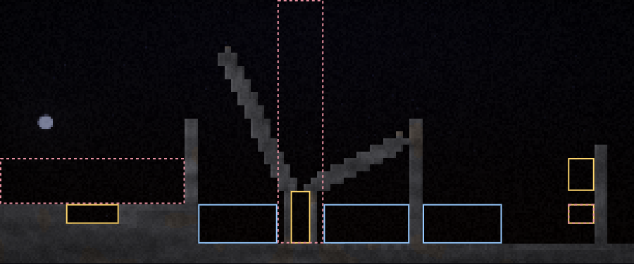 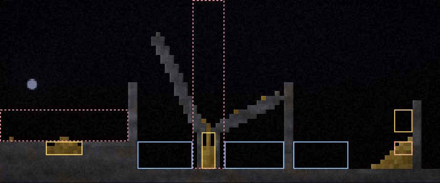

### 2-1 改道（Divert the Water）

- **id**：`c3-2-1-divert`，规划关，设计难度 1，时限 450 步，总预算 24 格
- **目标**：水池满了，水会从两边漫出来。让水只流向右边的田（至少 32 格），左边的村子一滴都不能进。
- **英文**：The pool is overflowing on both sides. Send the water only to the field on the right (at least 32 cells) and keep it out of the village.
- **教的机制**：引流：水从低的一侧漫出（Diverting: water spills over the lower side）
- **星级门槛**：二星 用料 ≤ 20、步数 ≤ 400；三星 用料 ≤ 16、步数 ≤ 300
- **预期解法「把左边池壁加高」**：3 星，1 笔、用料 14 格、44 步结算。笔画：STONE (25,8)→(25,13) 粗 2
- **备选解法「把左壁垒得更高」**：1 星，1 笔、用料 23 格、73 步结算。笔画：STONE (25,13)→(25,5) 粗 2
- **提示**：① 水往低处流，哪边的池壁矮就从哪边漫出去。 ② 只要把左边的池壁垒高，水就只能往右流。 ③ 在左池壁正上方竖着画一道两格粗、六七格高的石头。
- **难度指标**：随机通关 0/200（0.0%，随机通关中三星 0 次）；扰动通过 41/50，其中三星 32；空解失败；难度分 62
- **截图**：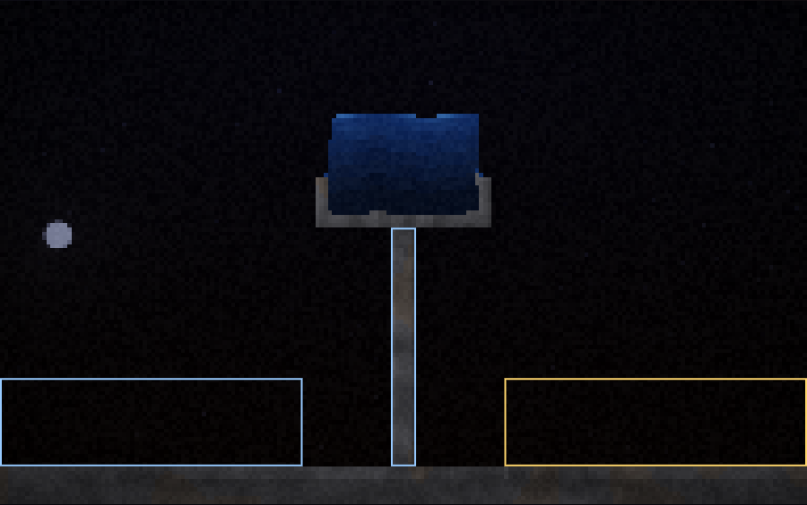 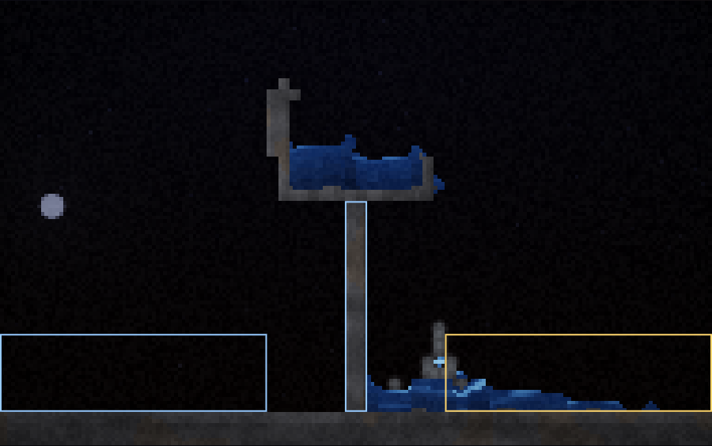

### 2-2 渡槽（The Aqueduct）

- **id**：`c3-2-2-aqueduct`，规划关，设计难度 2，时限 500 步，总预算 70 格
- **目标**：把高台水池漫出来的水引过深谷，送进右边的田（至少 30 格），谷底的矿井不能进水。
- **英文**：Carry the overflow from the high pool across the gorge to the field on the right (at least 30 cells) without flooding the mine below.
- **教的机制**：连通：搭渡槽把高处的水引到低处（Connecting: build an aqueduct to carry water downhill）
- **星级门槛**：二星 用料 ≤ 40、步数 ≤ 450；三星 用料 ≤ 24、步数 ≤ 350
- **预期解法「一格厚的渡槽」**：3 星，1 笔、用料 22 格、99 步结算。笔画：STONE (19,20)→(43,20) 粗 1
- **备选解法「三格厚的石桥」**：1 星，1 笔、用料 63 格、89 步结算。笔画：STONE (21,21)→(41,21) 粗 2
- **提示**：① 水需要一条连着两岸的路，否则就掉进谷底。 ② 石头连到两边的崖壁上就不会塌，一格厚就够。 ③ 从左崖顶一直到右崖边，画一条和崖顶齐平的一格石线。
- **难度指标**：随机通关 0/200（0.0%，随机通关中三星 0 次）；扰动通过 44/50，其中三星 30；空解失败；难度分 64
- **截图**：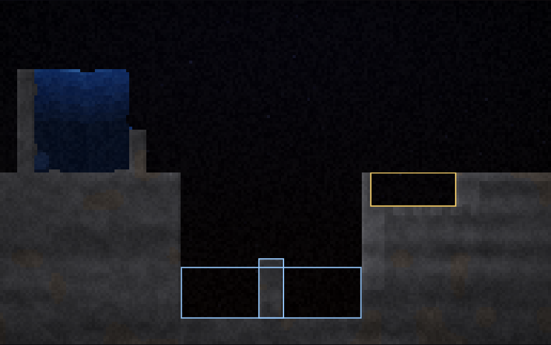 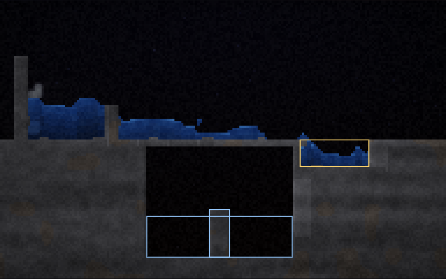

### 2-3 撇油（Skim the Oil）

- **id**：`c3-2-3-skim`，规划关，设计难度 2，时限 600 步，总预算 90 格
- **目标**：把罐里浮着的油顶出出油口，至少 18 格流进右边的油缸；水和沙子都不能流进去。
- **英文**：Push the floating oil out over the spout so at least 18 cells reach the oil tank on the right, without any water or sand following it.
- **教的机制**：密度分层：重的沉底、轻的上浮（Density layering: heavy sinks, light floats）
- **星级门槛**：二星 用料 ≤ 86、步数 ≤ 550；三星 用料 ≤ 78、步数 ≤ 450
- **预期解法「往罐里倒水把油顶出去」**：3 星，1 笔、用料 76 格、58 步结算。笔画：WATER (26,2)→(26,8) 粗 4
- **备选解法「倒盐水沉底顶油」**：3 星，1 笔、用料 69 格、97 步结算。笔画：SALTWATER (26,2)→(26,7) 粗 4
- **备选解法「多倒一些水」**：2 星，1 笔、用料 84 格、51 步结算。笔画：WATER (26,1)→(26,10) 粗 4
- **提示**：① 油比水轻，总是浮在最上面。 ② 往罐里加更重的液体，它会沉到油下面，把油整个往上顶。沙子会把水吸走，不管用。 ③ 罐里离出油口还差四行，往罐里倒七十格左右的水或盐水，油会先溢出来。
- **难度指标**：随机通关 0/200（0.0%，随机通关中三星 0 次）；扰动通过 50/50，其中三星 50；空解失败；难度分 72
- **截图**：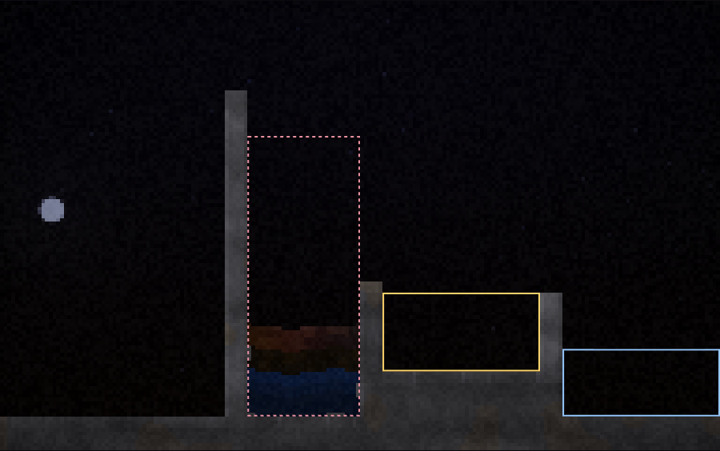 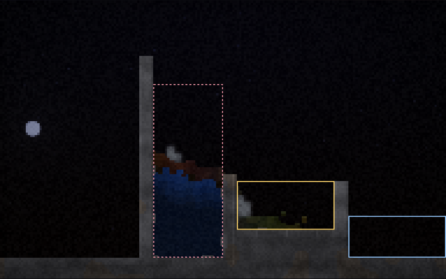

### 2-4 升筏（Raise the Raft）

- **id**：`c3-2-4-raft`，规划关，设计难度 2，时限 700 步，总预算 150 格
- **目标**：抬高闸里的水位，让木筏浮进金框并停稳；水不能漫过右边的闸墙淹到村子。
- **英文**：Raise the water in the lock until the raft floats up into the gold frame and stays there, without spilling over the right wall into the village.
- **教的机制**：浮力：水涨船高（Buoyancy: a rising tide lifts the raft）
- **星级门槛**：二星 用料 ≤ 100、步数 ≤ 650；三星 用料 ≤ 90、步数 ≤ 500
- **预期解法「在木筏两边倒水」**：3 星，2 笔、用料 76 格、363 步结算。笔画：WATER (22,12)→(25,13) 粗 3；WATER (38,12)→(41,13) 粗 3
- **备选解法「倒油也能托起木筏」**：2 星，2 笔、用料 76 格、558 步结算。笔画：OIL (22,12)→(25,13) 粗 3；OIL (38,12)→(41,13) 粗 3
- **备选解法「只在一边多倒」**：3 星，1 笔、用料 69 格、485 步结算。笔画：WATER (21,10)→(24,14) 粗 4
- **提示**：① 木头比水轻，水涨它就跟着往上浮。 ② 木筏正上方不能倒，在它两边倒；油比木头重，也能托起它。 ③ 在木筏左右各画一道三格粗的短横线，一共八十格左右，水位正好升到闸墙下面。
- **难度指标**：随机通关 1/200（0.5%，随机通关中三星 0 次）；扰动通过 43/50，其中三星 32；空解失败；难度分 73
- **截图**：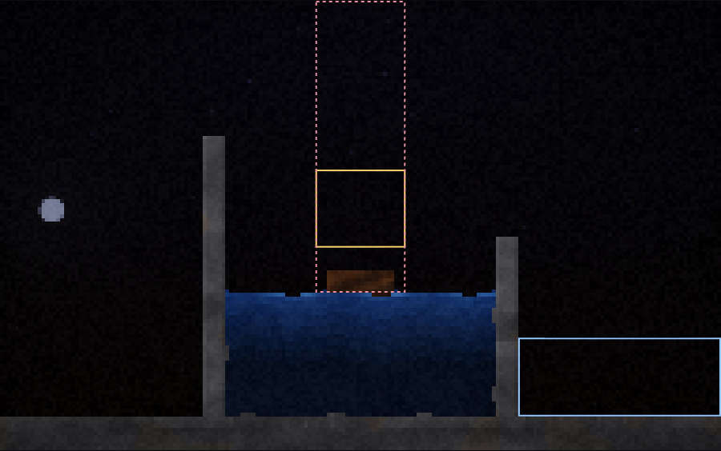 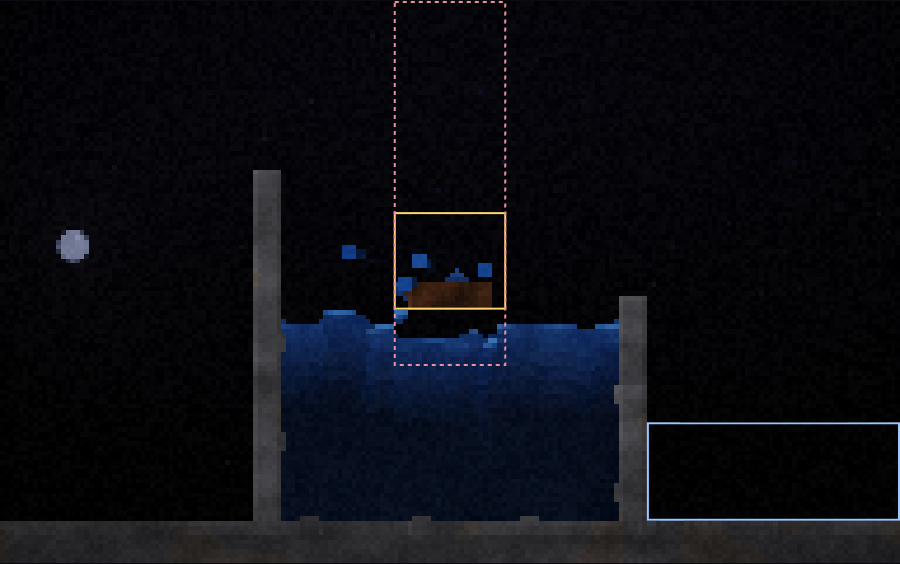

### 2-5 分水（Share the Spring）

- **id**：`c3-2-5-spring`，实时关，设计难度 3，时限 1200 步，总预算 30 格
- **目标**：泉水先流进左边的田。田灌满（80 格）以后及时把水改到右边，让闸里的木筏浮进金框。左边的村子不能进水。
- **英文**：The spring first runs into the left field. Once it holds 80 cells, switch the flow to the right so the raft in the lock floats into the gold frame. Keep the village dry.
- **教的机制**：综合：引流、浮力和时机（Review: diverting, buoyancy and timing）
- **星级门槛**：二星 用料 ≤ 24、步数 ≤ 1100；三星 用料 ≤ 12、步数 ≤ 900
- **预期解法「左田快满时把左端加高」**：3 星，1 笔、用料 4 格、401 步结算。笔画：第 200 步 STONE (26,8)→(26,11) 粗 1
- **备选解法「堵得又高又厚」**：2 星，1 笔、用料 17 格、375 步结算。笔画：第 200 步 STONE (27,6)→(27,10) 粗 2
- **提示**：① 分水台右端有沿，水只会从左端流下去；左端要是更高，水就改从右端流。 ② 太早改道，左田灌不满；太晚，左田满出来淹到村子。 ③ 看左田的水快到槽口时（大约第 330 步），在分水台左端竖着加三格高的石头。
- **难度指标**：随机通关 1/200（0.5%，随机通关中三星 0 次）；参考解法提前到第 0 步：失败；空解失败；难度分 51
- **截图**：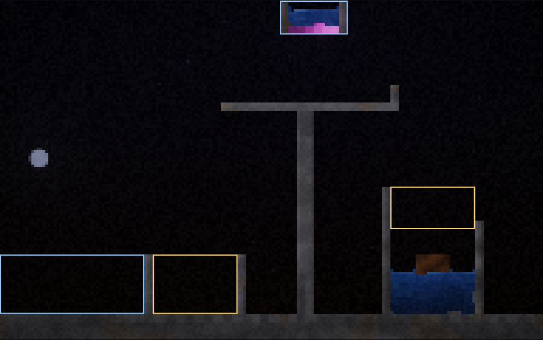 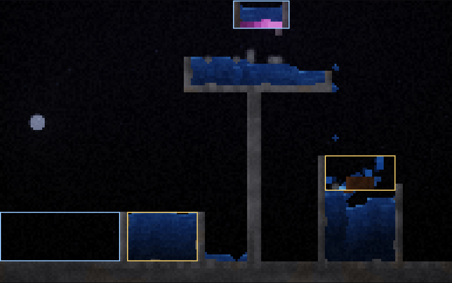

### 3-1 篝火（The Bonfire）

- **id**：`c3-3-1-bonfire`，规划关，设计难度 1，时限 700 步，总预算 12 格
- **目标**：点燃炉栅上的木堆，烧出至少 5 格木炭。
- **英文**：Light the woodpile on the grate and burn it until at least 5 cells of charcoal form.
- **教的机制**：点火：火往上烧（Ignition: fire burns upward）
- **星级门槛**：二星 用料 ≤ 11、步数 ≤ 650；三星 用料 ≤ 9、步数 ≤ 500
- **预期解法「炉膛里放一排火」**：3 星，1 笔、用料 8 格、246 步结算。笔画：FIRE (28,33)→(35,33) 粗 1
- **备选解法「炉膛里塞满火」**：1 星，1 笔、用料 12 格、248 步结算。笔画：FIRE (27,32)→(36,34) 粗 2
- **提示**：① 火焰是热气，会往上飘：放在木头上面或旁边，一下就飘走了。 ② 炉栅下面有一个三格高的炉膛，火放在那里会往上烤着木堆。 ③ 在炉膛里横着画一排八格的火。
- **难度指标**：随机通关 8/200（4.0%，随机通关中三星 1 次）；扰动通过 50/50，其中三星 50；空解失败；难度分 27
- **截图**：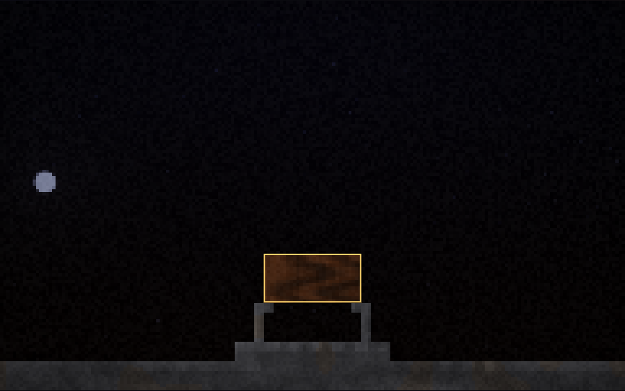 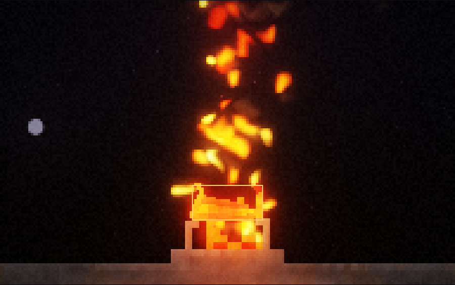

### 3-2 防火带（Firebreak）

- **id**：`c3-3-2-firebreak`，实时关，设计难度 2，时限 1600 步，总预算 20 格
- **目标**：草原中间起火了。拦住往两边烧的火：两座木屋都不能烧着，屋前的草场各留下至少 20 格干草。
- **英文**：The middle of the meadow is on fire. Stop it spreading both ways: neither cabin may burn, and each pasture in front of them must keep at least 20 cells of hay.
- **教的机制**：防火带：浸湿可燃物（Firebreaks: soak the fuel）
- **星级门槛**：二星 用料 ≤ 17、步数 ≤ 1600；三星 用料 ≤ 14、步数 ≤ 1600
- **预期解法「两边火头前各浇一道窄水带」**：3 星，2 笔、用料 13 格、1500 步结算。笔画：第 40 步 WATER (23,30)→(29,30) 粗 1；第 40 步 WATER (34,30)→(40,30) 粗 1
- **备选解法「早一点、浇得宽一些」**：2 星，2 笔、用料 17 格、1500 步结算。笔画：第 10 步 WATER (22,30)→(29,30) 粗 1；第 10 步 WATER (34,30)→(42,30) 粗 1
- **提示**：① 湿的草点不着。 ② 在火头前面浇一道水，把草地从上到下浇透，就成了防火带。 ③ 火刚烧起来时，在它左右两边几格外的草上各横着画一道七格的水。
- **难度指标**：随机通关 0/200（0.0%，随机通关中三星 0 次）；参考解法提前到第 0 步：仍通关；空解失败；难度分 66
- **截图**：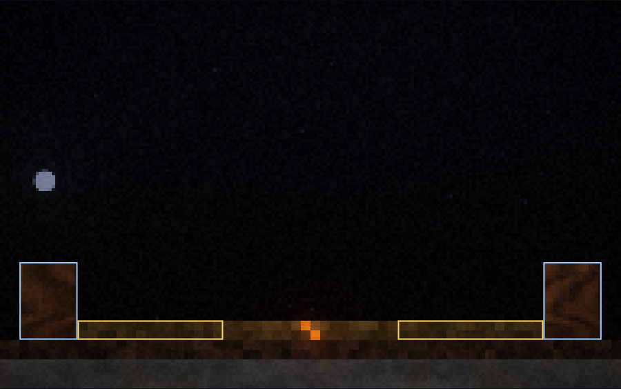 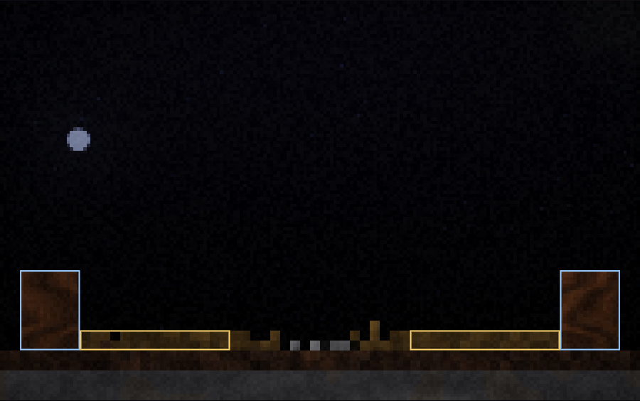

### 3-3 烧桥（Burn the Bridge）

- **id**：`c3-3-3-bridge`，规划关，设计难度 2，时限 1600 步，总预算 50 格
- **目标**：烧掉峡谷上的木桥，但旁边的木塔必须保住。
- **英文**：Burn down the wooden bridge over the gorge, but keep the wooden tower next to it standing.
- **教的机制**：湿木头：浸湿的木头不会着火（Wet wood: soaked wood does not catch fire）
- **星级门槛**：二星 用料 ≤ 38、步数 ≤ 1600；三星 用料 ≤ 28、步数 ≤ 1600
- **预期解法「先浇湿木塔，再从桥下点火」**：3 星，4 笔、用料 26 格、1400 步结算。笔画：WATER (46,9)→(50,9) 粗 1；WATER (46,8)→(50,8) 粗 1；FIRE (26,25)→(33,25) 粗 1；FIRE (26,26)→(33,26) 粗 1
- **备选解法「浇透木塔两侧」**：1 星，2 笔、用料 49 格、1400 步结算。笔画：WATER (44,6)→(52,6) 粗 2；FIRE (26,27)→(35,27) 粗 2
- **提示**：① 桥一烧，火会顺着木头烧到木塔上。 ② 湿木头点不着：先把木塔浇湿，再点火。火要放在桥下面。 ③ 在木塔顶上画两行水，在桥中间正下方的峡谷里画两排八格的火。
- **难度指标**：随机通关 2/200（1.0%，随机通关中三星 2 次）；扰动通过 46/50，其中三星 46；空解失败；难度分 72
- **截图**：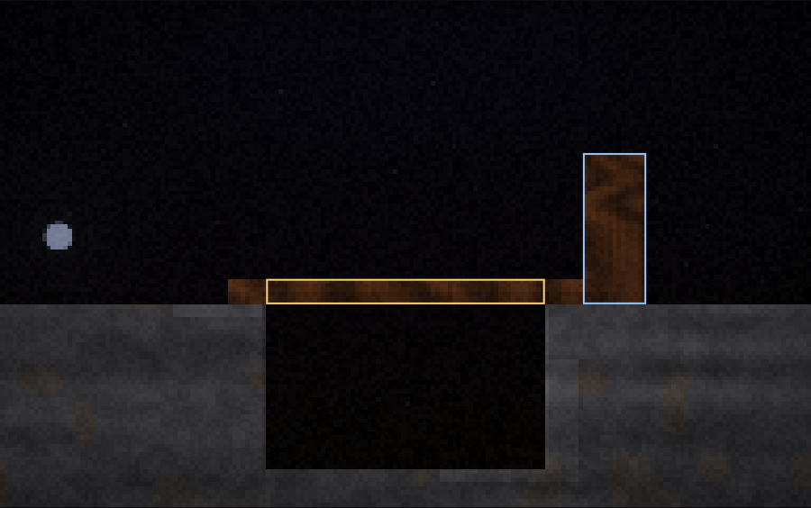 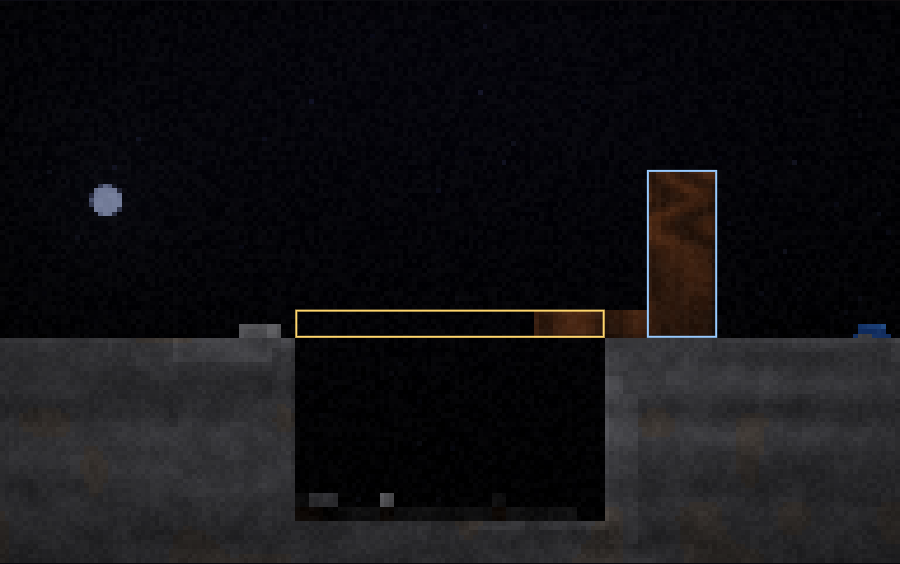

### 3-4 地窖失火（Cellar Fire）

- **id**：`c3-3-4-cellar`，实时关，设计难度 3，时限 1200 步，总预算 220 格
- **目标**：地窖里的木箱着火了。从屋顶的进水口灌水把火淹灭，至少保住七成木箱。
- **英文**：The crates in the cellar are on fire. Pour water through the hole in the roof to drown the fire and save at least 70% of the crates.
- **教的机制**：灭火：用水隔绝空气、带走热量（Firefighting: water cuts off air and carries away heat）
- **星级门槛**：二星 用料 ≤ 200、步数 ≤ 500；三星 用料 ≤ 180、步数 ≤ 320
- **预期解法「一着火就从进水口灌水」**：3 星，2 笔、用料 148 格、195 步结算。笔画：第 20 步 WATER (31,2)→(32,16) 粗 4；第 40 步 WATER (31,2)→(32,14) 粗 4
- **备选解法「慢慢灌」**：1 星，4 笔、用料 220 格、290 步结算。笔画：第 60 步 WATER (31,4)→(32,16) 粗 3；第 110 步 WATER (31,4)→(32,16) 粗 3；第 160 步 WATER (31,4)→(32,16) 粗 3；第 210 步 WATER (31,4)→(32,16) 粗 3
- **提示**：① 从上面泼水只能浇到表面，火会在里面接着烧。 ② 把整个地窖灌满，让水漫过燃烧的木箱，火就没有空气了。 ③ 火一着就在进水口正上方画两道粗水柱，一共一百八十格左右。
- **难度指标**：随机通关 0/200（0.0%，随机通关中三星 0 次）；参考解法提前到第 0 步：仍通关；空解失败；难度分 80
- **截图**：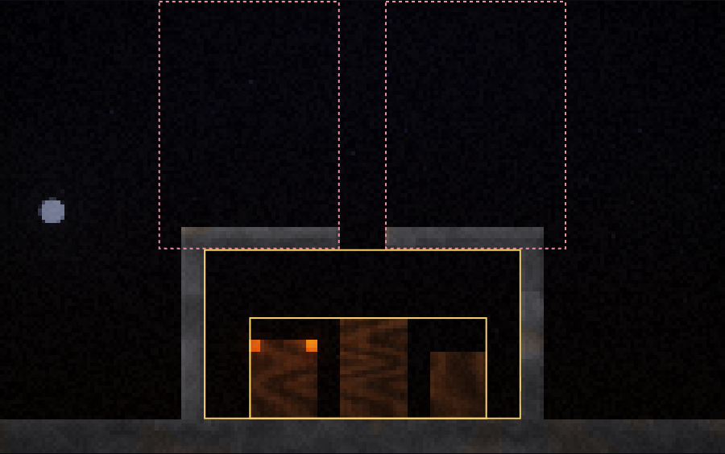 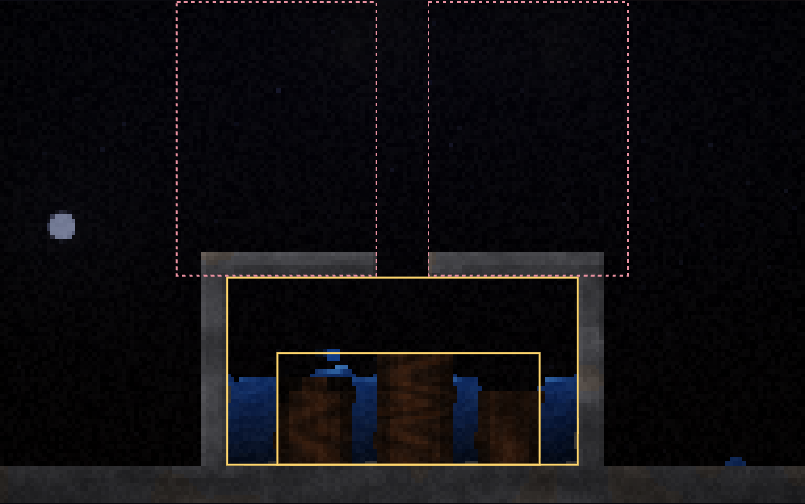

### 3-5 烽火台（Signal Beacon）

- **id**：`c3-3-5-beacon`，规划关，设计难度 4，时限 1200 步，总预算 46 格
- **目标**：点燃烽火台上的柴堆，烧掉一半以上；紧挨着的木岗亭不能烧着。
- **英文**：Light the woodpile on the beacon and burn more than half of it, without setting fire to the wooden hut right next to it.
- **教的机制**：综合：引火物、湿木头和引流（Review: tinder, wet wood and channelling water）
- **星级门槛**：二星 用料 ≤ 39、步数 ≤ 1200；三星 用料 ≤ 36、步数 ≤ 1200
- **预期解法「枯枝引火，斜槽引水浇岗亭」**：3 星，3 笔、用料 35 格、1000 步结算。笔画：DEADPLANT (42,20)→(49,20) 粗 1；FIRE (44,17)→(47,17) 粗 1；WATER (30,1)→(36,1) 粗 2
- **备选解法「两层枯枝、多浇水」**：1 星，4 笔、用料 46 格、1000 步结算。笔画：DEADPLANT (42,21)→(49,21) 粗 1；DEADPLANT (42,20)→(49,20) 粗 1；FIRE (44,18)→(47,18) 粗 1；WATER (29,1)→(37,1) 粗 2
- **提示**：① 只有四格火，直接点柴堆点不着，需要先烧着更容易着的东西。 ② 枯枝一点就着、烧得又旺又久；岗亭要先浇湿，水只能顺着斜槽流过去。 ③ 炉膛里铺一排枯枝，往上隔一两格放四格火；在斜槽高处倒二十来格水。
- **难度指标**：随机通关 2/200（1.0%，随机通关中三星 2 次）；扰动通过 46/50，其中三星 46；空解失败；难度分 69
- **截图**：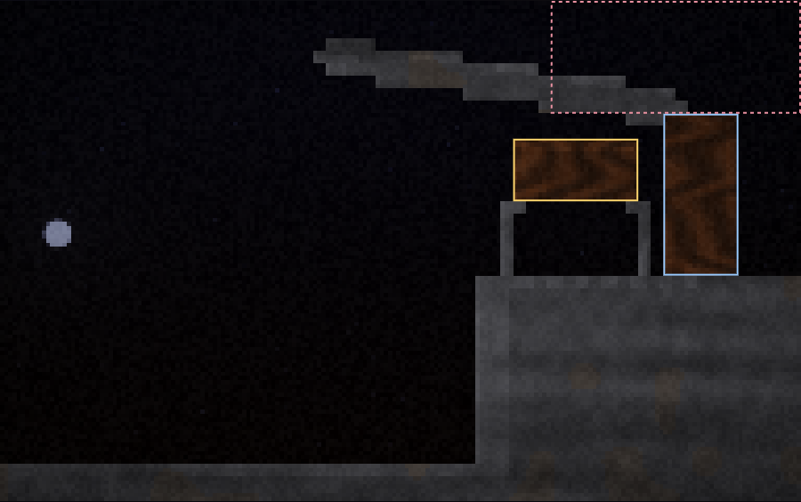 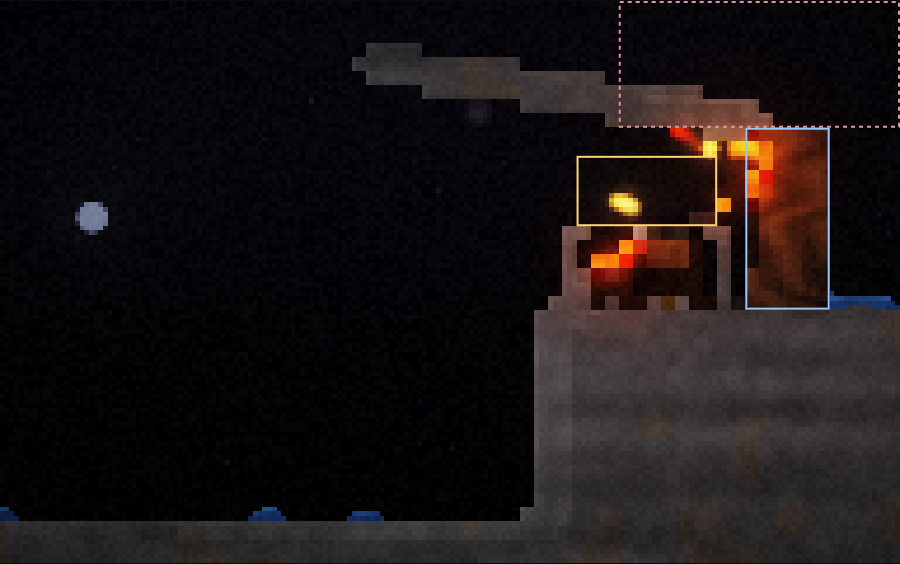

### 4-1 蒸汽搬水（Steam Lift）

- **id**：`c3-4-1-steam`，规划关，设计难度 2，时限 900 步，总预算 90 格
- **目标**：高处的蓄水池够不着。让至少 30 格水进到池里。
- **英文**：You cannot reach the high cistern. Get at least 30 cells of water into it.
- **教的机制**：汽化与凝结：水遇热成蒸汽，遇冷又成水（Boiling and condensing: water turns to steam in heat and back to water in the cold）
- **星级门槛**：二星 用料 ≤ 80、步数 ≤ 850；三星 用料 ≤ 70、步数 ≤ 700
- **预期解法「把水倒在熔岩上」**：3 星，1 笔、用料 67 格、205 步结算。笔画：WATER (11,20)→(19,26) 粗 3
- **备选解法「多倒一些」**：1 星，1 笔、用料 90 格、147 步结算。笔画：WATER (11,14)→(19,28) 粗 3
- **提示**：① 水碰到熔岩会变成蒸汽，蒸汽会往上升。 ② 蒸汽碰到凉的石顶会重新凝成水珠，顺着石顶流进蓄水池。 ③ 在左边竖井里、熔岩正上方画一大块水，七十格左右。
- **难度指标**：随机通关 7/200（3.5%，随机通关中三星 4 次）；扰动通过 50/50，其中三星 50；空解失败；难度分 43
- **截图**：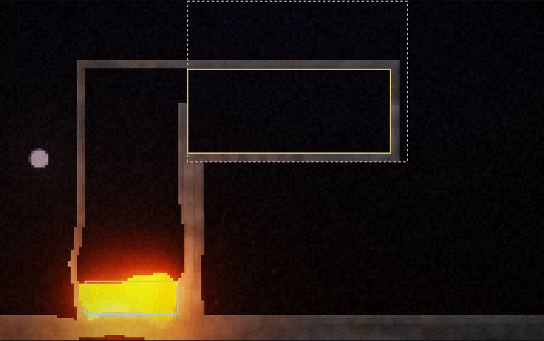 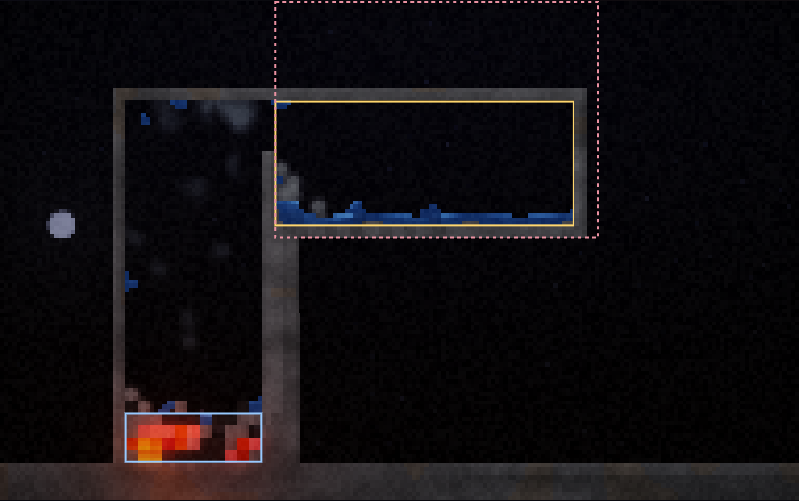

### 4-2 化雪（Snowmelt）

- **id**：`c3-4-2-snowmelt`，规划关，设计难度 2，时限 900 步，总预算 40 格
- **目标**：天冷，雪不会自己化。把两边雪池里的雪各化成至少 55 格水；中间冰窖的雪要留着，木棚顶不能烧着。
- **英文**：It is freezing, so snow will not melt by itself. Melt each of the two outer snow pools into at least 55 cells of water, but keep the snow in the icehouse between them and do not set the wooden roofs on fire.
- **教的机制**：熔化：固体吸热变成液体（Melting: solids absorb heat and turn liquid）
- **星级门槛**：二星 用料 ≤ 24、步数 ≤ 900；三星 用料 ≤ 14、步数 ≤ 900
- **预期解法「两个烟囱口各投一小股熔岩」**：3 星，2 笔、用料 12 格、600 步结算。笔画：LAVA (12,14)→(12,19) 粗 1；LAVA (52,14)→(52,19) 粗 1
- **备选解法「各投一大股」**：2 星，2 笔、用料 20 格、600 步结算。笔画：LAVA (12,10)→(12,19) 粗 1；LAVA (52,10)→(52,19) 粗 1
- **提示**：① 雪要吸够热才会化成水，火焰一飘就走，热量不够。 ② 熔岩落到雪上，会一边往下沉一边把周围的雪化掉；落到木棚顶上就会着火。 ③ 从两个烟囱口各竖着投六格熔岩就够了。
- **难度指标**：随机通关 2/200（1.0%，随机通关中三星 0 次）；扰动通过 50/50，其中三星 50；空解失败；难度分 58
- **截图**：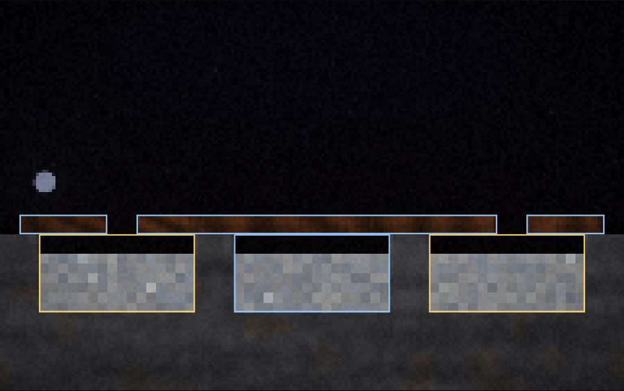 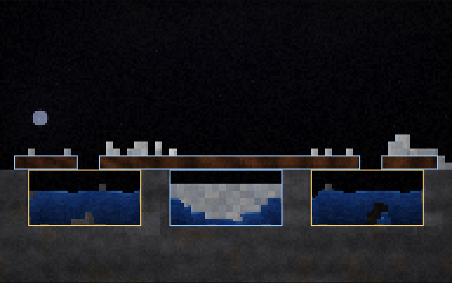

### 4-3 浇铸石板（Cast a Slab）

- **id**：`c3-4-3-cast`，规划关，设计难度 2，时限 400 步，总预算 110 格
- **目标**：在 150 步之内，用模子浇出一块石板（至少 30 格石头），两边的木棚不能着火。
- **英文**：Within 150 steps, cast a stone slab of at least 30 cells in the mold, without setting the wooden sheds on fire.
- **教的机制**：凝固：熔岩遇水冷却成石（Solidifying: water cools lava into stone）
- **星级门槛**：二星 用料 ≤ 90、步数 ≤ 150；三星 用料 ≤ 70、步数 ≤ 130
- **预期解法「一层熔岩一层水」**：3 星，2 笔、用料 64 格、107 步结算。笔画：LAVA (16,24)→(47,24) 粗 1；WATER (16,18)→(47,18) 粗 1
- **备选解法「一层熔岩、浇两层水」**：1 星，3 笔、用料 96 格、87 步结算。笔画：LAVA (16,24)→(47,24) 粗 1；WATER (16,18)→(47,18) 粗 1；WATER (16,16)→(47,16) 粗 1
- **提示**：① 熔岩冷到 850°C 以下就凝成石头，可是自己冷得太慢。 ② 往熔岩上浇水，水会瞬间汽化，把热量一起带走。 ③ 模子里倒一排熔岩，上方再画一排同样长的水。
- **难度指标**：随机通关 0/200（0.0%，随机通关中三星 0 次）；扰动通过 50/50，其中三星 50；空解失败；难度分 76
- **截图**：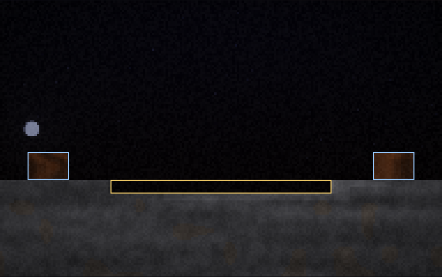 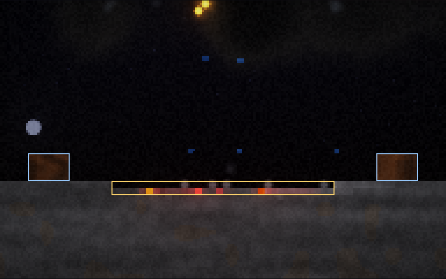

### 4-4 海水淡化（Desalination）

- **id**：`c3-4-4-desalt`，规划关，设计难度 3，时限 1400 步，总预算 20 格
- **目标**：海水会从高台上漫出来白白流走。想办法让蓄水池里攒下至少 20 格淡水，一点盐水都不能有。
- **英文**：Seawater spills off the cliff and runs to waste. Collect at least 20 cells of fresh water in the cistern, with no salt water at all.
- **教的机制**：综合：蒸馏把盐留下（Review: distillation leaves the salt behind）
- **星级门槛**：二星 用料 ≤ 12、步数 ≤ 1400；三星 用料 ≤ 7、步数 ≤ 1400
- **预期解法「从海边搭一小段石槽到竖井口」**：3 星，1 笔、用料 5 格、600 步结算。笔画：STONE (12,11)→(17,11) 粗 1
- **备选解法「搭一段三格厚的石槽」**：1 星，1 笔、用料 13 格、600 步结算。笔画：STONE (12,11)→(16,11) 粗 2
- **提示**：① 盐水碰到熔岩也会变成蒸汽，凝结下来的却是淡水。 ② 把漫出来的海水引进炉子竖井：从海边搭一段石槽，伸进竖井左墙上方的窗口。 ③ 紧贴着海的右壁，往右画一条五格长的石线，一直伸进竖井左墙上方的窗口。
- **难度指标**：随机通关 4/200（2.0%，随机通关中三星 0 次）；扰动通过 44/50，其中三星 44；空解失败；难度分 40
- **截图**：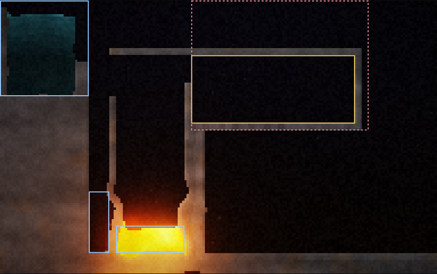 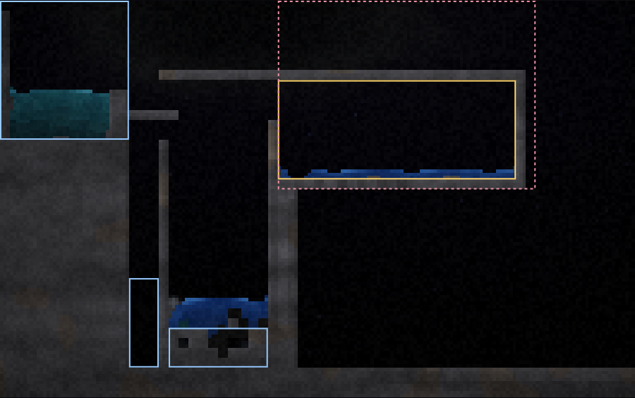

### 4-5 雪水上楼（Snow to the Rooftop）

- **id**：`c3-4-5-snowtower`，规划关，设计难度 4，时限 1600 步，总预算 40 格
- **目标**：竖井里塞满了冻雪。让至少 25 格水进到高处的蓄水池，旁边的木仓不能着火。
- **英文**：The shaft is packed with frozen snow. Get at least 25 cells of water into the high cistern, without setting the wooden barn on fire.
- **教的机制**：综合：熔化、汽化、凝结（Review: melting, boiling and condensing）
- **星级门槛**：二星 用料 ≤ 34、步数 ≤ 1600；三星 用料 ≤ 28、步数 ≤ 1600
- **预期解法「往雪上投三排熔岩」**：3 星，3 笔、用料 27 格、900 步结算。笔画：LAVA (11,18)→(19,18) 粗 1；LAVA (11,15)→(19,15) 粗 1；LAVA (11,12)→(19,12) 粗 1
- **备选解法「投四排熔岩」**：1 星，4 笔、用料 36 格、900 步结算。笔画：LAVA (11,18)→(19,18) 粗 1；LAVA (11,16)→(19,16) 粗 1；LAVA (11,14)→(19,14) 粗 1；LAVA (11,12)→(19,12) 粗 1
- **提示**：① 雪要先化成水，水还得再变成蒸汽才能升上去。 ② 熔岩一样东西就能把两件事都办了：先化雪，再把化出的水烧开。 ③ 在竖井雪面上方画三排熔岩，一共二十七格。
- **难度指标**：随机通关 4/200（2.0%，随机通关中三星 0 次）；扰动通过 48/50，其中三星 48；空解失败；难度分 60
- **截图**：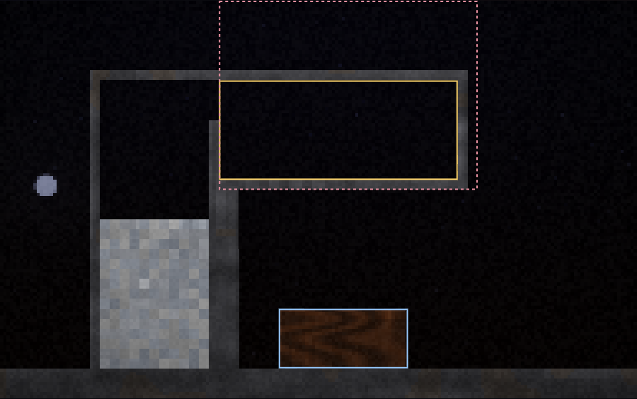 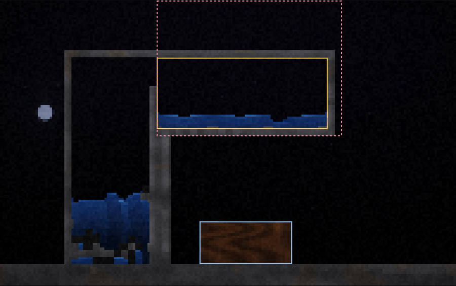

### 5-1 支柱（The Pillar）

- **id**：`c3-5-1-pillar`，规划关，设计难度 1，时限 400 步，总预算 60 格
- **目标**：石台悬在半空，一开始就会掉下来砸坏温室。给它撑住。
- **英文**：The stone ledge is hanging in mid-air and will fall onto the greenhouse as soon as time starts. Hold it up.
- **教的机制**：支撑：刚体要连到地面或锚点（Support: rigid bodies must connect to the ground or an anchor）
- **星级门槛**：二星 用料 ≤ 44、步数 ≤ 400；三星 用料 ≤ 24、步数 ≤ 400
- **预期解法「在一端立一根细柱」**：3 星，1 笔、用料 20 格、300 步结算。笔画：STONE (19,37)→(19,15) 粗 1
- **备选解法「两端各立一根粗柱」**：1 星，2 笔、用料 60 格、300 步结算。笔画：STONE (19,36)→(19,17) 粗 2；STONE (44,36)→(44,17) 粗 1
- **提示**：① 没有和地面或锚点连起来的石头会整块掉下来。 ② 柱子只要从地面一直连到石台底下就行，温室上方不能放东西。 ③ 在石台左端下面，从地面竖着画一根一格粗的石柱。
- **难度指标**：随机通关 0/200（0.0%，随机通关中三星 0 次）；扰动通过 50/50，其中三星 50；空解失败；难度分 64
- **截图**： 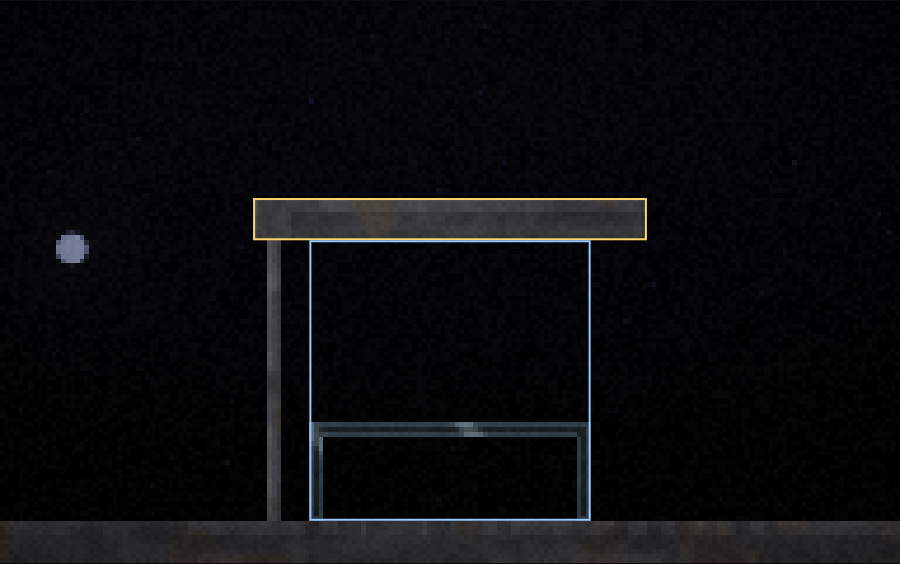

### 5-2 吊灯（Hang the Lamp）

- **id**：`c3-5-2-hang`，规划关，设计难度 2，时限 400 步，总预算 40 格
- **目标**：一块石灯悬在温室上方，开始后会掉下来。用绳子把它吊在顶上的锚点上。
- **英文**：A stone lamp hangs above the greenhouse and will fall when time starts. Hang it from the anchor overhead with rope.
- **教的机制**：绳子：把东西吊在锚点上（Rope: hang loads from an anchor）
- **星级门槛**：二星 用料 ≤ 28、步数 ≤ 400；三星 用料 ≤ 14、步数 ≤ 400
- **预期解法「一根绳子吊住」**：3 星，1 笔、用料 13 格、300 步结算。笔画：ROPE (31,1)→(31,15) 粗 1
- **备选解法「两根绳子吊住」**：2 星，2 笔、用料 26 格、300 步结算。笔画：ROPE (30,1)→(30,15) 粗 1；ROPE (33,1)→(33,15) 粗 1
- **提示**：① 锚点固定不动，连着它的东西都不会掉。 ② 温室上方不能垫东西，只能从上面吊；沙子撑不住它。 ③ 从锚点正下方竖着画一根绳子，一直连到石灯顶上。
- **难度指标**：随机通关 0/200（0.0%，随机通关中三星 0 次）；扰动通过 50/50，其中三星 50；空解失败；难度分 61
- **截图**：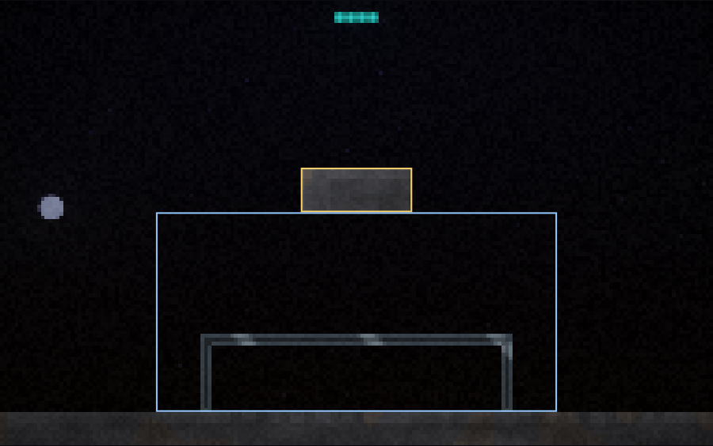 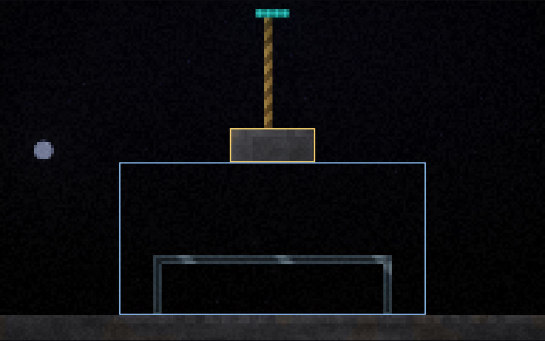

### 5-3 定点爆破（Controlled Demolition）

- **id**：`c3-5-3-blast`，规划关，设计难度 2，时限 700 步，总预算 30 格
- **目标**：炸掉中间的砖墙（至少毁掉四分之三），两边的木屋要保住。
- **英文**：Blow up the brick wall in the middle (at least three quarters of it) while keeping both wooden houses intact.
- **教的机制**：TNT 和引线：用火药引爆（TNT and fuses: prime it with gunpowder）
- **星级门槛**：二星 用料 ≤ 20、步数 ≤ 700；三星 用料 ≤ 13、步数 ≤ 700
- **预期解法「TNT 贴墙竖一排，火药引子，熔岩点火」**：3 星，3 笔、用料 13 格、400 步结算。笔画：TNT (28,30)→(28,36) 粗 1；GUNPOWDER (24,35)→(27,35) 粗 1；LAVA (24,33)→(25,33) 粗 1
- **备选解法「多放 TNT、拉一条长引线」**：1 星，3 笔、用料 22 格、400 步结算。笔画：TNT (28,28)→(29,36) 粗 1；GUNPOWDER (16,36)→(27,36) 粗 1；LAVA (16,34)→(17,34) 粗 1
- **提示**：① TNT 不怕热也不怕水，直接拿熔岩烤不着，得有东西先炸起来引爆它。 ② 火药一碰熔岩就燃爆，正好用来当引子。TNT 的爆炸半径大约 15 格。 ③ 紧贴墙根竖着放一排七格 TNT，旁边地上铺四格火药，再在火药上方点两格熔岩。
- **难度指标**：随机通关 8/200（4.0%，随机通关中三星 3 次）；扰动通过 41/50，其中三星 41；空解失败；难度分 39
- **截图**：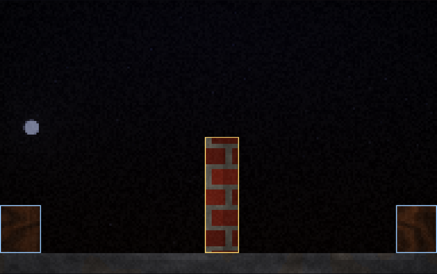 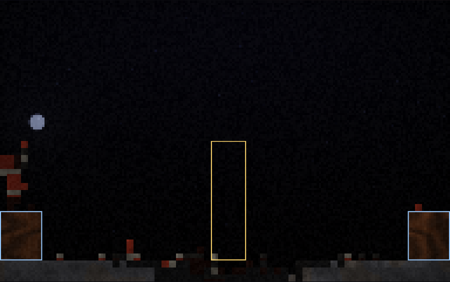

### 5-4 掐断引线（Cut the Fuses）

- **id**：`c3-5-4-fuses`，实时关，设计难度 3，时限 1500 步，总预算 40 格
- **目标**：两条干草引线从中间烧起来，正往两边的炸药库烧。在火烧到之前把它们掐断，引线上至少留下 60 格干草。
- **英文**：Two hay fuses are burning outward from the middle toward the explosives depots on both sides. Cut them before the fire gets there, keeping at least 60 cells of the fuses unburnt.
- **教的机制**：综合：引线、防火带和时机（Review: fuses, firebreaks and timing）
- **星级门槛**：二星 用料 ≤ 24、步数 ≤ 1500；三星 用料 ≤ 14、步数 ≤ 1500
- **预期解法「两边火头前各浇一小段水」**：3 星，2 笔、用料 9 格、1400 步结算。笔画：第 40 步 WATER (22,30)→(26,30) 粗 1；第 40 步 WATER (37,30)→(41,30) 粗 1
- **备选解法「稍晚一些、浇得长一点」**：2 星，2 笔、用料 15 格、1400 步结算。笔画：第 60 步 WATER (19,30)→(25,30) 粗 1；第 60 步 WATER (38,30)→(45,30) 粗 1
- **提示**：① 沙子盖在草上挡不住火，草下面还是干的。 ② 湿草点不着：在两边火头前各浇一段水，把草浇透。 ③ 一开始就在中间火堆左右各十格左右的草上，各画一道五格的水。
- **难度指标**：随机通关 2/200（1.0%，随机通关中三星 0 次）；参考解法提前到第 0 步：仍通关；空解失败；难度分 56
- **截图**：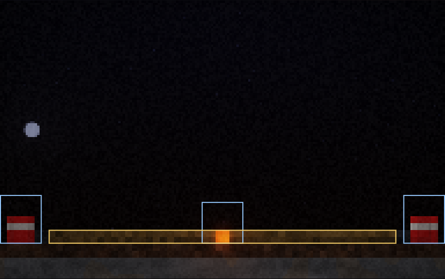 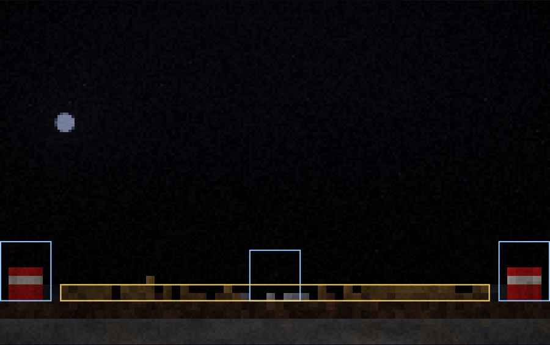

### 5-5 炸坝引水（Breach the Dam）

- **id**：`c3-5-5-breach`，规划关，设计难度 4，时限 900 步，总预算 80 格
- **目标**：炸开砖坝，让至少 30 格湖水流进田里。田上方悬空的石桥要先撑住，右边的木屋也要保住。
- **英文**：Blow open the brick dam so at least 30 cells of lake water flow into the field. Hold up the stone bridge hanging over the field first, and keep the wooden house on the right intact.
- **教的机制**：综合：支撑、爆破与引水（Review: support, demolition and water）
- **星级门槛**：二星 用料 ≤ 60、步数 ≤ 900；三星 用料 ≤ 45、步数 ≤ 900
- **预期解法「先立柱，再引爆坝脚」**：3 星，4 笔、用料 42 格、700 步结算。笔画：STONE (57,37)→(57,5) 粗 1；TNT (25,31)→(26,36) 粗 1；GUNPOWDER (27,35)→(30,35) 粗 1；LAVA (29,33)→(30,33) 粗 1
- **备选解法「两根柱子、多放火药」**：1 星，5 笔、用料 72 格、700 步结算。笔画：STONE (57,37)→(57,5) 粗 1；STONE (41,37)→(41,5) 粗 1；TNT (25,31)→(26,36) 粗 1；GUNPOWDER (27,34)→(30,35) 粗 1；LAVA (29,32)→(30,32) 粗 1
- **提示**：① 石桥一开始就会掉下来；TNT 要靠火药引爆。 ② 柱子立在离坝远的一端，爆炸就伤不到它。 ③ 在石桥右端下面（木屋左边）立一根石柱；坝脚右侧竖放一排 TNT，旁边铺四格火药，上面点两格熔岩。
- **难度指标**：随机通关 0/200（0.0%，随机通关中三星 0 次）；扰动通过 43/50，其中三星 43；空解失败；难度分 83
- **截图**：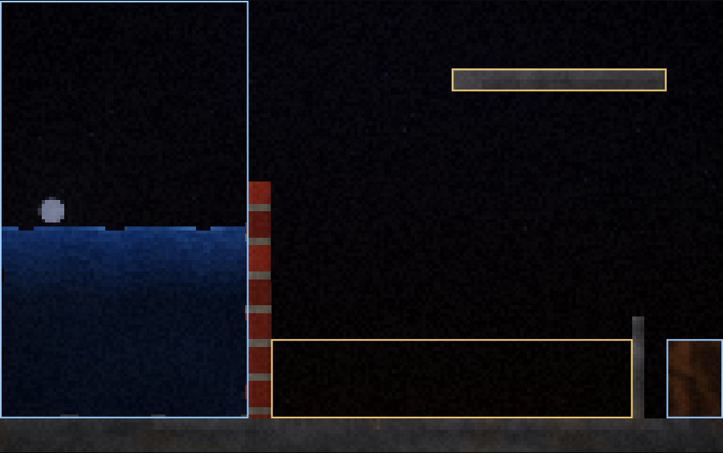 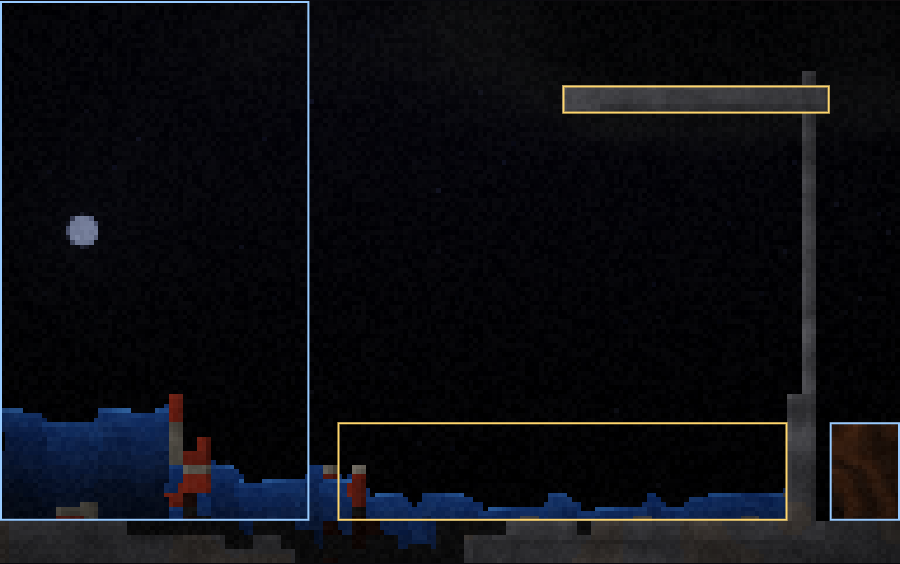

### 6-1 接通电路（Close the Circuit）

- **id**：`c3-6-1-circuit`，规划关，设计难度 2，时限 500 步，总预算 32 格
- **目标**：电线断了一截。接上它，让电火花顺着电线跑到另一头，引爆 TNT 炸开巨石。
- **英文**：A stretch of the wire is missing. Repair it so a spark can run along the wire to the far end, set off the TNT and blast the boulder.
- **教的机制**：导电：电火花沿金属传导（Conduction: sparks travel along metal）
- **星级门槛**：二星 用料 ≤ 28、步数 ≤ 450；三星 用料 ≤ 22、步数 ≤ 300
- **预期解法「补上缺口，再在金属桩旁点电火花」**：3 星，2 笔、用料 16 格、120 步结算。笔画：METAL (20,36)→(29,36) 粗 2；SPARK (1,31)→(3,31) 粗 1
- **备选解法「整段再铺一层，多点几个火花」**：2 星，4 笔、用料 26 格、119 步结算。笔画：METAL (20,36)→(29,36) 粗 2；METAL (12,35)→(19,35) 粗 1；SPARK (1,31)→(3,31) 粗 1；SPARK (1,29)→(3,29) 粗 1
- **提示**：① 电火花会顺着金属一路跑过去，跑到头就点着挨着的炸药。 ② 电线中间缺了六格，金属必须连成一条线才导电。 ③ 用两格粗的笔刷把缺口补上，再在左边金属桩旁边点电火花。
- **难度指标**：随机通关 1/200（0.5%，随机通关中三星 0 次）；扰动通过 50/50，其中三星 35；空解失败；难度分 63
- **截图**：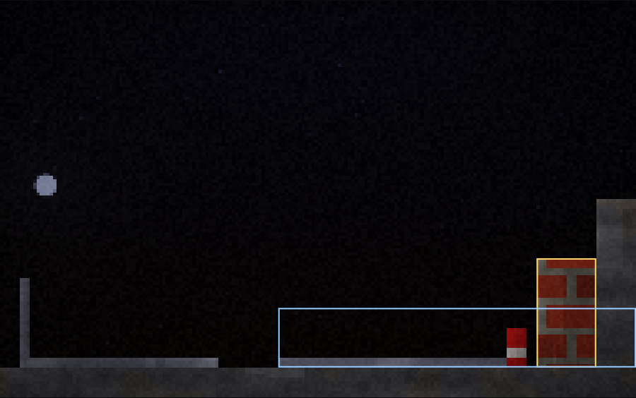 

### 6-2 水渠导电（The Wet Wire）

- **id**：`c3-6-2-canal`，规划关，设计难度 2，时限 500 步，总预算 34 格
- **目标**：TNT 埋在水渠尽头的干沟里。让电火花传过去引爆它，炸开巨石。
- **英文**：The TNT is buried in a dry ditch at the end of the canal. Send a spark there to set it off and blast the boulder.
- **教的机制**：导电：水也能传电（Conduction: water carries current too）
- **星级门槛**：二星 用料 ≤ 30、步数 ≤ 450；三星 用料 ≤ 24、步数 ≤ 300
- **预期解法「往干沟里灌水接通，再在金属桩旁放火花」**：3 星，2 笔、用料 20 格、105 步结算。笔画：WATER (43,32)→(50,32) 粗 2；SPARK (10,27)→(12,27) 粗 1
- **备选解法「往干沟里填金属」**：3 星，2 笔、用料 20 格、101 步结算。笔画：METAL (43,32)→(50,32) 粗 2；SPARK (10,27)→(12,27) 粗 1
- **提示**：① 水也导电，只是每走一格都会损耗，大约能传四十格。 ② 水渠和 TNT 之间还隔着一段干沟，要先接上。TNT 不怕水。 ③ 往干沟里灌满水，再在左边金属桩旁点电火花。
- **难度指标**：随机通关 4/200（2.0%，随机通关中三星 3 次）；扰动通过 50/50，其中三星 50；空解失败；难度分 53
- **截图**： 

### 6-3 绕开木屋（Reroute the Line）

- **id**：`c3-6-3-reroute`，规划关，设计难度 3，时限 600 步，总预算 104 格
- **目标**：引爆右边的 TNT 炸开巨石。旧电线从木屋底下穿过，通了电会把木屋烤着。
- **英文**：Set off the TNT on the right to blast the boulder. The old wire runs under the wooden houses and would set them alight if it carried current.
- **教的机制**：导电的副作用：通电金属会发热（A side effect of conduction: live metal gets hot）
- **星级门槛**：二星 用料 ≤ 98、步数 ≤ 600；三星 用料 ≤ 88、步数 ≤ 600
- **预期解法「贴着屋顶上方拉一条新线」**：3 星，4 笔、用料 88 格、400 步结算。笔画：METAL (2,26)→(59,26) 粗 1；METAL (57,25)→(57,34) 粗 2；SPARK (2,22)→(4,22) 粗 1；SPARK (2,30)→(4,30) 粗 1
- **备选解法「从桩顶拉一条高线」**：3 星，3 笔、用料 70 格、400 步结算。笔画：METAL (4,20)→(57,20) 粗 1；METAL (57,21)→(57,34) 粗 1；SPARK (2,22)→(4,22) 粗 1
- **提示**：① 通电的金属会烤热紧挨着的可燃物，木头碰着就着。 ② 别去接旧电线的缺口，从电桩另拉一条不碰木头的新线到 TNT。 ③ 从电桩中段往右拉一条横线，比屋顶高出两格以上，到 TNT 上方再往下拐，贴到 TNT 旁边。
- **难度指标**：随机通关 5/200（2.5%，随机通关中三星 5 次）；扰动通过 50/50，其中三星 27；空解失败；难度分 68
- **截图**： 

### 6-4 顺水通电（Current on the Tide）

- **id**：`c3-6-4-flowspark`，实时关，设计难度 3，时限 900 步，总预算 20 格
- **目标**：泉水正在灌满水渠。等水接到另一头的 TNT，再放电火花引爆它炸开巨石；水渠满了会漫进左边的村子。
- **英文**：The spring is filling the canal. Once the water reaches the TNT at the far end, send a spark to set it off and blast the boulder; when the canal is full it will spill into the village on the left.
- **教的机制**：综合：水流、导电与时机（Review: flowing water, conduction and timing）
- **星级门槛**：二星 用料 ≤ 8、步数 ≤ 800；三星 用料 ≤ 3、步数 ≤ 500
- **预期解法「水一接到 TNT 就在金属桩旁放火花」**：3 星，1 笔、用料 1 格、289 步结算。笔画：第 180 步 SPARK (7,23)→(9,23) 粗 1
- **备选解法「晚一点、多放几个火花」**：3 星，2 笔、用料 2 格、425 步结算。笔画：第 320 步 SPARK (7,23)→(9,23) 粗 1；第 330 步 SPARK (7,25)→(9,25) 粗 1
- **提示**：① 电火花只闪一下：水还没连到 TNT 时放，电会半路断掉。 ② 看着水头走到 TNT 跟前，再在泡在水里的金属桩旁放火花；别等水渠漫出来。 ③ 大约第 120 步水会碰到 TNT，之后在金属桩旁横着点三格电火花。
- **难度指标**：随机通关 7/200（3.5%，随机通关中三星 2 次）；参考解法提前到第 0 步：失败；空解失败；难度分 21
- **截图**： 

### 6-5 一火双响（One Spark, Two Blasts）

- **id**：`c3-6-5-doubleshot`，实时关，设计难度 4，时限 900 步，总预算 24 格
- **目标**：用电火花把高处和水渠尽头的两包 TNT 都引爆。泉水正在灌渠，渠满了会淹到村子。
- **英文**：Use sparks to set off both charges of TNT: the one up high and the one at the end of the canal. The spring is filling the canal, which will flood the village when full.
- **教的机制**：综合：导线、水路与时机（Review: wires, water paths and timing）
- **星级门槛**：二星 用料 ≤ 18、步数 ≤ 850；三星 用料 ≤ 12、步数 ≤ 600
- **预期解法「先补线，水接到下面的 TNT 再放火花」**：3 星，2 笔、用料 7 格、293 步结算。笔画：METAL (19,6)→(26,6) 粗 1；第 180 步 SPARK (7,24)→(9,24) 粗 1
- **备选解法「晚一点补线，分两次放火花」**：1 星，3 笔、用料 21 格、372 步结算。笔画：第 100 步 METAL (19,6)→(26,6) 粗 2；第 260 步 SPARK (7,24)→(9,24) 粗 1；第 400 步 SPARK (9,27)
- **提示**：① 电桩同时连着上面的电线和下面的水渠，一个火花两头都能跑。 ② 上面的电线断了一截要补上；下面要等水流到 TNT 跟前才导得通。 ③ 一开始就用一排金属补上高线缺口，等到第 120 步以后，在电桩旁点三格电火花。
- **难度指标**：随机通关 9/200（4.5%，随机通关中三星 5 次）；参考解法提前到第 0 步：失败；空解失败；难度分 27
- **截图**： 

---

数据由 `node tools/c3/audit.mjs` 于 2026-11-27 生成，原始结果见 [puzzle-levels-report.json](puzzle-levels-report.json)。
